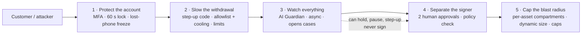

# SAIFE: hot-wallet security for crypto exchanges

**A working proof of concept that limits, slows down and exposes hot-wallet theft, without slowing down trading.**

Prepared by Dzoan Nguyen Tran, DevOps and Cloud Engineer · 12 November 2026 · for exchange security, custody and platform leadership

> Simulation only: mock funds, mock signer, no real private keys, no exchange connectivity. Every control below runs as real code against simulated balances so it can be inspected, attacked and measured.

---

## 1. What is it?

SAIFE is an exchange platform design on AWS, with a running demo, built around one question: **if an attacker gets in, how much can they take, how fast, and who notices?**

The demo contains:

- **A spot exchange:** order book, matching engine, double-entry ledger and 500 req/s load.
- **A customer mobile app:** MFA sign-in, a 60-second server-enforced lock, lost-phone response and step-up withdrawals.
- **Compartmentalized hot wallets:** one wallet per asset and network, each sized dynamically and capped.
- **An AI Guardian:** watches every withdrawal and opens cases for humans. It cannot move funds.
- **An Ops Console:** live architecture, Grafana-style monitoring, an attack lab and a human review queue.

## 2. What problem does it solve?

**Hot wallets are where exchanges lose money.** They must stay online to pay withdrawals in seconds, so their keys and approval paths are reachable from the internet-facing platform.

In May 2019, attackers took about 7,000 BTC from Binance's hot wallet in a single transaction. They used stolen API keys, 2FA codes and other account data gathered over time. Funds outside the hot wallet were untouched; the customer accounts and the hot wallet were the weak points.

The same pattern repeats across the industry:

| Weakness | What the attacker does |
|---|---|
| Account takeover | Phishes or steals a password, MFA code, session or API key, then withdraws as the customer |
| Oversized hot wallet | Drains everything sitting online, often far more than a day of withdrawals needs |
| One path to signing | Compromises one system, employee or script that can approve and sign transfers |
| Slow detection | Moves funds across many accounts in minutes, before anyone looks |
| New attack surface | Tricks an AI reviewer with instructions hidden in a withdrawal memo |

## 3. How does SAIFE solve it?

Five layers. Each assumes the one before it can fail.



| Layer | What it does | What it stops |
|---|---|---|
| **1. Protect the account** | Password plus an authenticator code or passkey. The server locks the session after 60 s idle and resuming needs MFA. A lost phone can be reported from any browser: every session is revoked and withdrawals are frozen until a human reviews. | Stolen passwords, hijacked sessions, unattended phones, stolen devices |
| **2. Slow the withdrawal** | A fresh authenticator code for every withdrawal. Funds can only go to allowlisted addresses, new addresses wait out a cooling period (24 h in production), and per-transaction and daily limits apply. | An attacker with a live session draining the account in one go |
| **3. Watch everything** | The AI Guardian reads every committed event asynchronously and spots coordinated withdrawals, new-device high-value transfers, ledger mismatches, order floods and prompt injection. It applies only pre-approved, reversible holds and leaves the decisions to humans. | Multi-account, minutes-long drains that rules on one account miss |
| **4. Separate the signer** | Top-ups and sweeps need two different human roles, then a signer that re-checks the policy: destination allowlisted, within cap, ledger reconciled. The Guardian's identity has no signing permission; a request to sign is **denied and audited**. | One compromised system, insider or AI agent moving treasury funds |
| **5. Cap the blast radius** | One hot wallet per asset and network (BTC, ETH, USDC). Each holds only forecast withdrawals plus fees plus a 25% buffer, inside a hard cap. The excess is swept to cold storage. | "Everything online is gone": the worst case becomes one compartment's capped balance |

Two design rules hold throughout:

- **The Guardian never slows trading.** It sits beside the order path, never in it. Fast deterministic checks run before an order is accepted; analysis runs afterwards.
- **Withdrawals fail closed; trading fails open.** If the Guardian is down or lagging, withdrawals wait for screening while trading continues.

## 4. So what? Proof from the demo

Press **▶ Run demo**. It starts with a scripted MFA sign-in, then runs 75 seconds of real engine code:

| Scenario | What happens | Result in the test suite |
|---|---|---|
| **Hot-wallet drain:** stolen credentials on 8 accounts, all withdrawing to one address | The Guardian links them in seconds, holds every withdrawal, freezes the accounts, pauses the BTC compartment and pages on-call | **0 BTC leaves the platform** |
| **Compromised AI Guardian** tries to sign transfers | The policy service refuses every privileged call | ≥ 3 calls **DENIED** and audited |
| **Ledger tampering:** balance edited without ledger entries | Reconciliation detects it; withdrawal blocked, compartment paused | Tampered funds not withdrawn; balances reversed after review |
| **Lost phone** reported from another browser | All sessions revoked, devices marked lost, withdrawals frozen; a stolen password alone cannot re-enrol MFA | Freeze holds until a reviewer closes the case |
| **Order flood** | Per-account rate limit, then Guardian hold, then edge block | Trading continues for everyone else |
| **Availability Zone failure** | Matching fails over with a fencing token; no duplicate trades | p99 recovered in about 8 s (simulated) |

Test evidence: **20/20** platform checks and **44/44** mobile security checks pass. Measured locally, a single process handles 500 req/s at a p99 of 2.3 ms. These are simulation results, not production claims; section 8 shows exactly what is real.

## 5. Benefits

| For | Benefit |
|---|---|
| **Treasury** | Loss is capped per compartment instead of covering everything online. Dynamic sizing keeps less capital idle in hot wallets, so more stays in cold storage. |
| **Security** | Several independent layers, so one stolen credential, session, employee or AI agent is not enough to move funds. |
| **Customers** | A stolen phone or password does not mean an emptied account. Active traders are not interrupted: the lock applies only when idle, and step-up applies only to risky actions. |
| **Trading performance** | Detection is asynchronous, so the order path stays within the p99 < 100 ms target. |
| **Operations** | One console for the architecture, live metrics, open cases, approvals and audit trail. Every automated action is explainable and reversible. |
| **Compliance and audit** | Every decision is logged with actor, action, policy version and correlation id. A human approves every high-impact action. |
| **AI adoption** | Shows how to use AI for detection without handing it the keys. |

## 6. What next?

A staged path from demo to production. Nothing touches real funds until an independent security review.

| Phase | Duration | Output |
|---|---|---|
| **0. Discovery** | 1–2 weeks | Threat model, withdrawal-demand data per asset, custody boundaries, success metrics agreed |
| **1. Testnet pilot** | 3–4 weeks | Connect to a vetted MPC/HSM custody provider on testnet; real wallet sizing and two-person approval flows |
| **2. Guardian in shadow mode** | 3–4 weeks | Run the Guardian on a replay of real (anonymized) withdrawal events; measure detection rate, false positives and time to detect. **No automatic actions.** |
| **3. Performance and resilience** | 2 weeks | 500 req/s with p99 < 100 ms on AWS (k6 or Locust), Availability Zone failure and cross-Region restore drills, revocation-latency tests |
| **4. Production readiness** | Separate scope | Independent penetration test and custody review, runbooks, launch decision |

Facts still needed, and the assumption used meanwhile:

| Needed | How to get it | Assumed meanwhile |
|---|---|---|
| Real withdrawal-demand curves per asset | Treasury data export | Synthetic forecast + 25% buffer |
| Current custody and signing architecture | Custody team workshop | MPC 2-of-3 signer, mocked |
| Acceptable false-positive rate for holds | Risk and customer-support input | Holds are reversible and reviewed within minutes |

## 7. Call to action: Binance

**To Binance security, custody and platform engineering leadership:**

The 2019 hot-wallet incident was caused by exactly the attack this demo stops: stolen account credentials turned into a fast, multi-account withdrawal. SAIFE shows, in running code, how to make that attack **bounded, slow and visible**, while keeping AI useful and away from the keys.

**Proposed next step:**

1. **45-minute live walkthrough.** Run the hot-wallet drain, lost-phone and compromised-AI scenarios together, then go through the architecture.
2. **6-week testnet pilot** (phases 0–2 above). Shadow-mode Guardian on your event stream, with no automatic actions and no production funds.

**Contact:** Dzoan Nguyen Tran, DevOps and Cloud Engineer. Open an issue on this repository to schedule a walkthrough.

---

## 8. Try it in two minutes

```bash
./start.sh                 # background start, waits until healthy, prints URLs (Node 18+, zero npm deps)
./start.sh --fg            # foreground instead (or: npm start)
./start.sh --status | --logs | --stop
PORT=3511 ./start.sh       # another port (default 3510)
```

| Page | URL |
|---|---|
| Trading UI | http://127.0.0.1:3510 |
| Ops Console | http://127.0.0.1:3510/ops.html |
| Mobile app | http://127.0.0.1:3510/mobile (login **demo / SaifeDemo!2026**) |
| Prometheus metrics | http://127.0.0.1:3510/metrics |

### On AWS EC2 (Amazon Linux 2023 or Ubuntu)

```bash
sudo dnf install -y git || sudo apt-get install -y git
git clone https://github.com/Sherlock2019/Saifecryptobank.git saife && cd saife
./start.sh --install --public --tls   # Node.js 20 if missing, binds 0.0.0.0, HTTPS (self-signed), prints https://<public-ip>:3510
```

- A t3.small (or larger) is enough.
- In the instance Security Group, open inbound **TCP 3510 to your IP only**. The trading UI and ops console have no login; only the mobile app does.
- `--tls` creates a self-signed certificate for the public IP in `.run/tls/`. The browser warns once (Advanced → Proceed). Without `--tls`, traffic, including passwords, is unencrypted.
- Alternative without opening the port: run `./start.sh`, then from your laptop run `ssh -L 3510:127.0.0.1:3510 ubuntu@<ec2-ip>` (`ec2-user@` on Amazon Linux) and browse http://127.0.0.1:3510. This is also the only way to try passkeys, which browsers block on a raw IP address.
- The server keeps running after you log out (`nohup`). Stop it with `./start.sh --stop`.

### The guided demo

Press **▶ Run demo** on the Trading UI or the Ops Console. It opens with a scripted sign-in mockup (prefilled credentials, a live authenticator code, MFA verification; **Skip** or **Cancel** available), then resets the simulation and runs about 75 s:

1. Baseline traffic, then a ramp to **500 req/s**, with p99 shown live.
2. A market order, then an idempotent retry using the same `clientOrderId` (no duplicate fill).
3. A normal withdrawal: 2 s screening hold → Guardian clears it → mock MPC signer → hot wallet shrinks → top-up proposal.
4. **Attack: hot-wallet drain** (2019-style stolen API keys across 8 accounts).
5. **Attack: order flood:** rate limit → Guardian velocity hold → WAF edge block.
6. **Chaos: AZ failure:** matching lease failover with a fencing token, Aurora reader promotion, pod rescheduling.
7. Human review: confirm or dismiss cases, approve treasury top-ups.

## 9. Technical reference

### Mobile app (`/mobile`)

A phone frame on desktop, full screen on a real phone. Sign in with **demo / SaifeDemo!2026** (set `MOBILE_DEMO_PASSWORD` to change it; the hint is then hidden). It trades and withdraws on its own account `cust-1` through the same engine, Guardian and custody controls as the web UI. On first sign-in, add the setup key to Google or Microsoft Authenticator, 1Password or Authy, or tap **Add to the demo authenticator**, and save the 8 recovery codes.

| Layer | What the server enforces (`mobile-api.js`) |
|---|---|
| Customer identity | Password (scrypt) + TOTP (RFC 6238, each code works once) or a WebAuthn passkey with user verification. 5 failures → 5 min lockout + Guardian alert. |
| Session protection | Server-side session, HttpOnly SameSite=Strict cookie (Secure under TLS), CSRF token, ID rotated after MFA. **Locks after 60 s without interaction**; polling doesn't count. Unlock needs MFA. |
| Lost-device response | Password + recovery code → every session ended, devices marked lost, passkeys removed, authenticator reset, withdrawals frozen, case `LOST_DEVICE_REPORTED` opened. A reviewer closing the case lifts the freeze. Re-enrolment needs another recovery code. |
| Authorization | Scopes per session state (MFA pending / enrolment / active / locked). The account always comes from the session; a body field such as `acct: "trader-1"` is ignored. |
| Trading protection | Tick/lot, ±5% band, max value, rate limit, atomic reservation, idempotent `clientOrderId`. |
| Withdrawal protection | Fresh TOTP per withdrawal, allowlisted destinations only, new addresses wait 60 s (24 h in production), per-tx caps, $25,000 daily limit, then Guardian screening and the mock signer. |
| Data and secrets | User store `.run/mobile-users.json` is AES-256-GCM encrypted (key from `SAIFE_DATA_KEY` or `.run/data.key`, mode 0600). Recovery codes and session tokens stored only as hashes. Strict CSP, `X-Frame-Options: DENY`, nosniff, HSTS under TLS. |
| Audit and monitoring | Every auth, lock, device, address and withdrawal event goes to Ops Console → Audit as `cust:demo`. |
| Device attestation (optional) | Browser signals give a risk score; ≥ 60 blocks withdrawals and opens a case. A native app would use App Attest or Play Integrity. |

Security → **Live security checks** sends real attack-style requests and shows each refusal. Reset mobile users with `./start.sh --stop && rm .run/mobile-users.json`. Tunables: `MOBILE_IDLE_MS` (60000), `MOBILE_ALLOWLIST_COOLDOWN_MS` (60000), `MOBILE_DAILY_LIMIT_USD` (25000), `MOBILE_DEMO_PASSWORD`, `SAIFE_DATA_KEY` (64 hex chars).

### Platform components

| Area | Where | What happens |
|---|---|---|
| Spot trading | Trade page | Limit and market orders, cancel, live book, 5 s candles, trades, open orders, history, balances, ledger |
| Guardrails (TR-02/03) | `placeOrder()` | Tick/lot/min/max notional, ±5% price band, per-account rate limit, atomic reservation, idempotent `clientOrderId`, ACCEPTED only after commit |
| Matching (TR-04) | `matchOrder()` | Price-time priority, self-trade prevention, IOC, partial fills; one fenced owner per market with standby in the other AZ |
| Ledger (TR-05) | `execTrade()` | Integer units (sats, micro-USDT), 4 balanced entries per trade, per-account ledger totals, reconciliation every 2 s |
| Outbox (TR-06) | `emit()` / `guardianTick()` | At-least-once relay injects duplicates; the consumer dedupes by sequence |
| AI Guardian | `guardianEval()` | Async, never in the order path. Rules: order velocity, spoofing/layering, wash trading, new device + high value, coordinated ATO, balance without ledger, prompt-injection memo, outflow velocity. Shadow-model score is shown but never acts |
| Policy service | `policyApply()` | Allows only pre-approved, reversible actions: holds, step-up, compartment pause. Anything else, such as `SIGN_TX`, is **DENIED** and audited |
| Hot wallets | Ops → Hot Wallets | BTC / ETH / USDC compartments with caps; target = clamp(forecast + fees + 25% buffer); top-ups and sweeps need 2 different human roles, then a mock signer; calculator reproduces the scope example (0.40 + 0.10 → 0.35 BTC) |
| Attack Lab | Ops → Attack Lab | 8 scenarios with a live timeline (attacker / WAF / Guardian / policy) and a human review queue |
| Grafana-style dashboard | Ops → Grafana | RPS, p50/p95/p99 vs 100 ms SLO, errors/rejects/WAF, Guardian lag, hot-wallet % of cap, pods and CPU per AZ, Alertmanager rules |
| Chaos & DR | Ops → Chaos & DR | Load slider (0–1000 rps), fail/restore an AZ, matching leases, cross-Region DR drill (timings compressed, RPO = snapshot age) |
| Audit (TR-08) | Ops → Audit | Actor, action, target, decision, policy version, case, correlation id |

### What is real vs simulated

- **Real code running on mock data:** order validation, reservation, matching, ledger, reconciliation, outbox and dedupe, Guardian rules, policy allowlist, wallet sizing, approvals, MFA/TOTP, sessions and idle lock, lost-device response, Prometheus text output.
- **Simulated:**
  - CloudFront/WAF, ALB, EKS pods and nodes, Aurora/ElastiCache failover, SQS, Cognito (the web UI uses a fixed `trader-1` session; the Run demo sign-in is a scripted mockup), MPC signer, blockchain (fake txids) and the DR Region.
  - **Latency:** in-process handler time is measured, and modeled AWS hop latency (edge, ALB, Aurora commit) is added. This is a demo signal, not evidence of the AWS p99. On AWS, run the same mix with k6 or Locust from the agreed geography against the ALB.
  - **Synthetic load** runs through the real engine functions in-process. `scripts/loadtest.mjs` measures real HTTP round trips locally.

### Tests

```bash
npm run smoke                       # 20 end-to-end checks (orders, idempotency, guardrails, withdrawals, attacks, recon, /metrics)
# 44 mobile security checks; needs a fresh user store and short timers:
SAIFE_RUN_DIR=$(mktemp -d) MOBILE_IDLE_MS=6000 MOBILE_ALLOWLIST_COOLDOWN_MS=3000 PORT=3599 node server.js &
node scripts/mobile-smoke.mjs http://127.0.0.1:3599
node scripts/loadtest.mjs 500 20    # real HTTP load: 500 req/s for 20 s
```

Last local runs, 12 Nov 2026:
- Smoke test: 20/20 pass. Mobile security checks: 44/44 pass.
- Synthetic load: 518 req/s at p99 ≈ 10 ms (modeled). During an AZ failure, p99 rose to about 150 ms and recovered in about 8 s.
- Real HTTP load test: 500 req/s at p99 2.3 ms (local, single process).

### How it was built

- Single Node.js process (`server.js`), no npm dependencies; state is in memory and resets on restart or via **Reset**.
- Static frontend in `public/`: plain HTML, CSS and JS. Charts are drawn on `<canvas>` with a small helper in `common.js`. Live updates use Server-Sent Events (`/api/stream`).
- Built with Claude Code from the scope-of-work document, kept as a simple POC. Production items are deliberately out of scope: CloudFormation templates, Helm charts, a real Cognito integration, a real Prometheus/Grafana deployment and a real custody provider.

```
server.js            engine + simulation + HTTP/SSE API
mobile-api.js        mobile auth/security API (/api/m/*)
public/index.html    trading UI          public/trade.js
public/ops.html      ops console         public/ops.js
public/mobile.html   mobile app          public/mobile.js  public/mobile.css  public/totp.js
public/common.js     helpers, charts, demo sign-in stage   public/style.css
scripts/smoke.mjs    end-to-end checks   scripts/loadtest.mjs  HTTP load test
scripts/mobile-smoke.mjs  mobile security checks
```
